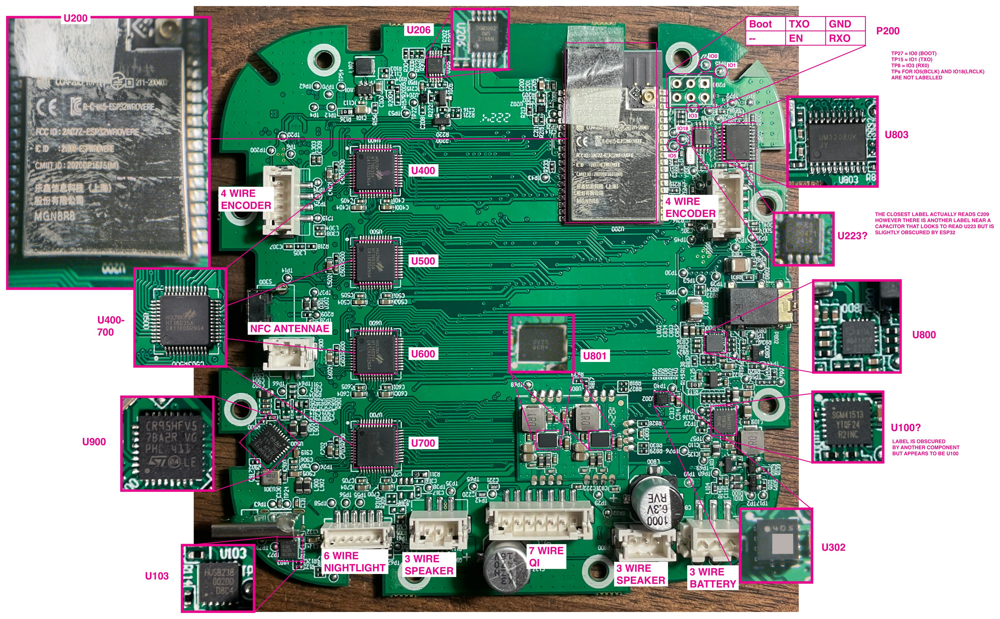

# Yoto Player V3 teardown

Teardown notes for the full-size Yoto Player 3rd generation, plus a small Arduino sketch that plays a tone through both original speakers. It's tested on real V3 hardware and uses the datasheet power-up sequence, with no Yoto firmware or DSP blobs.

**The key finding:** the V3 uses two AW88194 smart amps at I2C 0x34 and 0x37. They stay in reset, and invisible to an I2C scan, until IO expander pin IOX.2.4 goes high. Stock firmware does that at boot. Custom firmware has to do it too.

[**Video**](https://github.com/user-attachments/assets/d955e8e3-7148-4fcc-8168-46cc7206af2c)

## What's here

| Path | What it is |
| --- | --- |
| [`firmware/yoto_v3_amp_test/`](firmware/yoto_v3_amp_test/) | Arduino sketch that wakes both amps and beeps |
| [`docs/disassembly.md`](docs/disassembly.md) | Opening the player without breaking it |
| [`docs/download-mode.md`](docs/download-mode.md) | Wiring, download mode, backup and restore |
| [`docs/hardware-reference.md`](docs/hardware-reference.md) | I2C, GPIO, IO expander, flash, connector and chip maps |
| [`photos/`](photos/) | Teardown and board photos |

## Waking the speakers

1. Write the stock IO expander values, outputs before directions. This sets IOX.2.4 high and releases the amps. It also sets the power hold, IOX.3.1.

   | Chip | Output p0 (0x02) | Output p1 (0x03) | Direction p0 (0x06) | Direction p1 (0x07) |
   | --- | --- | --- | --- | --- |
   | 0x20 | 0xFF | 0xFF | 0xFE | 0xFF |
   | 0x21 | 0x5F | 0xDF | 0x00 | 0xD4 |

2. Wait at least 5 ms. 0x34 and 0x37 should now answer a scan. Register 0x00 on each reads 0x1806.
3. Start I2S: BCLK GPIO5, LRCLK GPIO18, data GPIO19, MCLK GPIO0. Keep clocks running at least 5 ms, since the amp's PLL locks to BCLK by default.
4. Write 0x05 (I2SCTRL). `0x0C08` gives mono (L+R)/2, standard I2S, 16-bit, BCLK 32fs, 48 kHz.
5. In 0x04 (SYSCTRL), set I2SEN (bit 6) and clear PWDN (bit 0), keeping AMPPD (bit 1) set. Poll 0x01 until bit 0 (PLL locked) is 1.
6. In 0x04, clear AMPPD. Poll 0x01 until bit 8 (switching) is 1.
7. In 0x08 (PWMCTRL), clear HMUTE (bit 0). Hardware mute is on by default.
8. Set volume in the upper byte of 0x0F: bits 7:4 × 6 dB, bits 3:0 × 0.5 dB, down from 0 dB.

Amp registers are 16-bit, sent high byte first after an 8-bit register address. Use read-modify-write on 0x04 to keep reserved bits. If it stays silent, register 0x01 is the place to look: PLL locked (bit 0), clocks stable (bit 4), no PLL reference (bit 5), switching (bit 8), boost started (bit 9).

## Test results

Run Nov 1, 2026, powered from USB-C with the original speakers attached and the battery unplugged. Volume −24 dB, 30% sine at 480 Hz, 48 kHz 16-bit, mono mix on both amps. The tone was clearly audible from both speakers.

| Check | Result |
| --- | --- |
| I2C scan after expander setup | 0x08 0x09 0x18 0x1A 0x20 0x21 0x34 0x37 0x51 0x62 0x65 0x75 |
| Chip ID, both amps | 0x1806 |
| Status after PLL lock | 0x4011: locked, clocks stable, undervoltage set while boost is off |
| Status after amp on | 0x0311: locked, clocks stable, switching, boost started, undervoltage cleared |
| After three beeps | Unchanged |

The board reset with a brownout (`E BOD`) when USB-C was unplugged. That's expected with no battery attached. A boot message about an invalid core dump image is harmless, because the stock partition table has no core dump partition.

## Running the sketch

Back up first: see [`docs/download-mode.md`](docs/download-mode.md). The sketch needs the Arduino IDE with esp32 core 3.x, board **ESP32 Wrover Module**. Enter download mode, then upload. Do a full power cycle afterward.

Volume starts low on purpose. Raise `VOLUME_DB_DOWN` in small steps. Results go to Serial at 115200 and to `amp_test_log.txt` on the SD card, because my programming wires and speakers couldn't stay connected together.

## How this relates to open-yoto

[open-yoto](https://github.com/tensorfish/open-yoto) got there first on the amp, and it's well worth reading. It's replacement firmware for the Yoto Mini, it has a working AW88194 driver, and its config #05 lists the same IOX.2.4 and 0x34/0x37 details as the V3-E. It doesn't support full-size players.

| | open-yoto (as of its Sept 2026 code) | This repo |
| --- | --- | --- |
| Tested on | Yoto Mini | Full-size V3 (V3-E config) |
| Amps started | One, at 0x34 | Both, 0x34 and 0x37 |
| Method | Loads Yoto's register table and DSP firmware | Datasheet sequence only, no DSP load |
| Output | Full audio player | Test tone |
| Physical teardown | Links to Adafruit | Connectors, chips, header, fuses |

Yoto's stock firmware loads DSP firmware and tuning into the amp, and this sketch doesn't. I don't know how the amps behave at high volume without it, so go up slowly.

## Why 0x64 isn't the amp here

Adafruit's guide lists the AW88194 at 0x64. On this V3, 0x64 is the CW2215B battery gauge, and the AW88194 datasheet only allows 0x34–0x37.

## Still unknown

- Which amp is really left and which is right. The plain V3 config has them swapped.
- Running on battery alone.
- What 0x62 and 0x75 are.
- Whether 0x65 is the AW2028H night light driver. open-yoto's notes on the stock firmware point that way.
- Whether 0x64 returns with the battery attached. The CW2215B gauge didn't answer in the amp-test scan, and the battery was unplugged.
- What the third wire in each speaker harness does. The black wire stops inside the foam tape, and red and white continue to the speaker.
- The p0–p3 port order across the two expanders.
- Why IOX.0.0, a Qi interrupt, is set as an output.
- Where the LIS2DH12 sits, and what's on the night light and Qi boards.

If you have a V3 and can answer any of these, please open an issue. Results from other V3 boards are especially useful, since I've only seen one.

## Related work

- [Hacking Yoto Music Players](https://learn.adafruit.com/hacking-the-yoto-music-players) (Adafruit): the Mini-focused guide this started from
- [open-yoto](https://github.com/tensorfish/open-yoto): replacement firmware for the Yoto Mini, with a working amp driver and detailed reverse-engineering docs
- [Yoto-Mini-ESPHome](https://github.com/Scags104/Yoto-Mini-ESPHome): ESPHome config for the Mini
- [AW88194 product page](https://www.awinic.com/en/productDetail/AW88194CSR) (Awinic): the datasheet is marked confidential, so it isn't reposted here
- [FCC internal photos](https://fccid.io/2AS6W-PRP3XX01755/Internal-Photos/Internal-photos-6603750)

## Notes

Independent project, not affiliated with or endorsed by Yoto. No Yoto firmware is included here. You do this at your own risk: it can brick your player and will void any warranty.

Code is MIT ([`LICENSE`](LICENSE)). Docs and photos are CC BY 4.0 ([`LICENSE-docs.md`](LICENSE-docs.md)).

By Zack.
