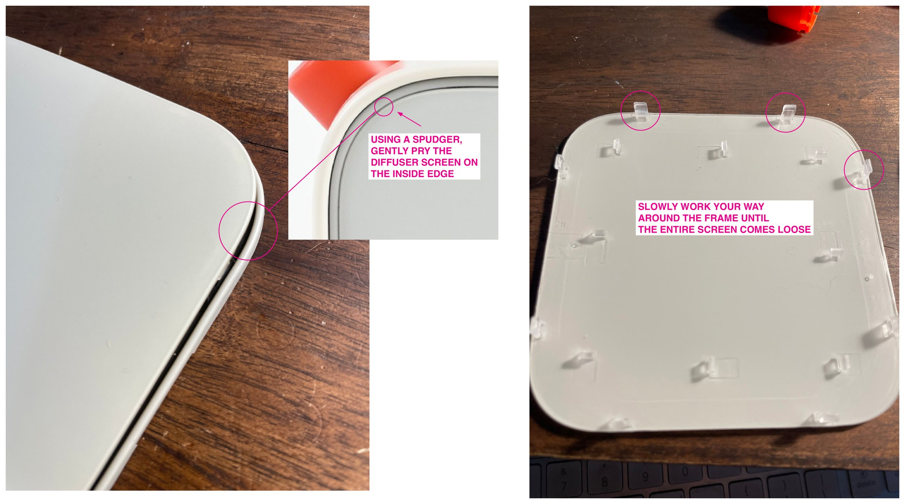
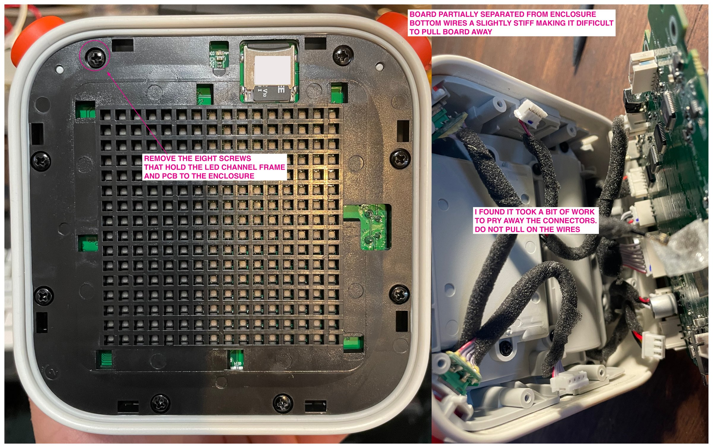
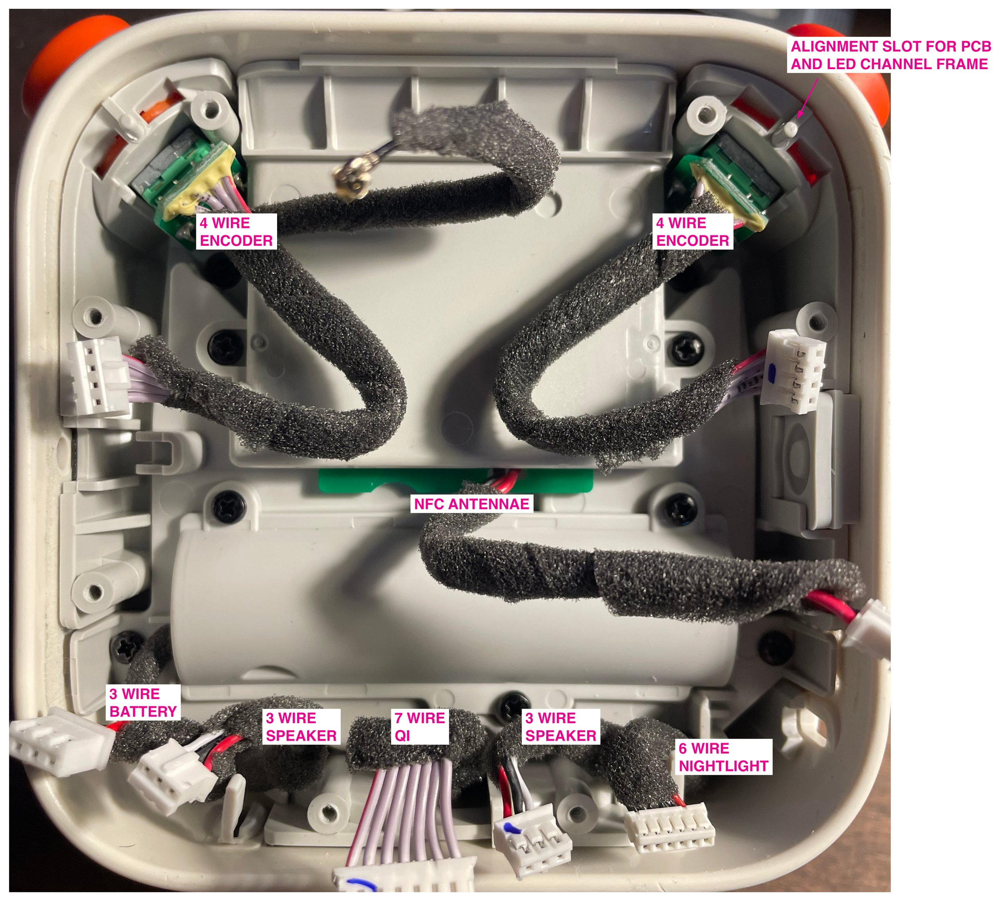
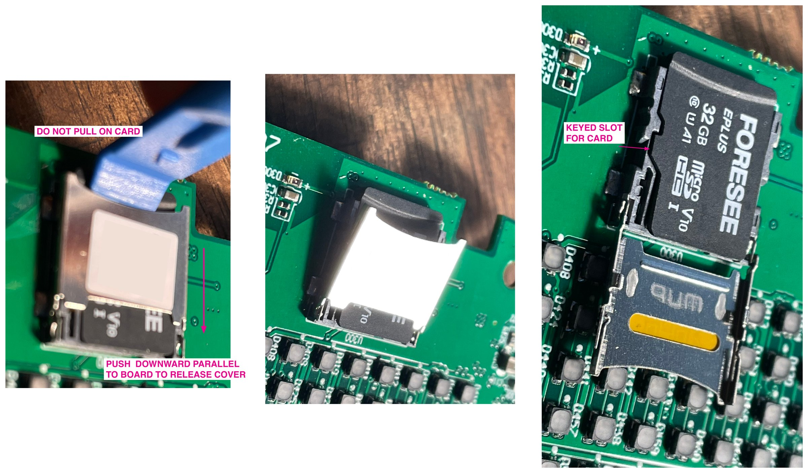
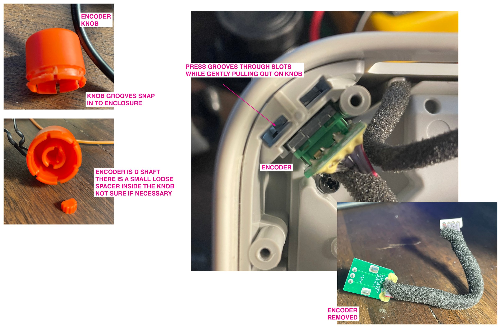
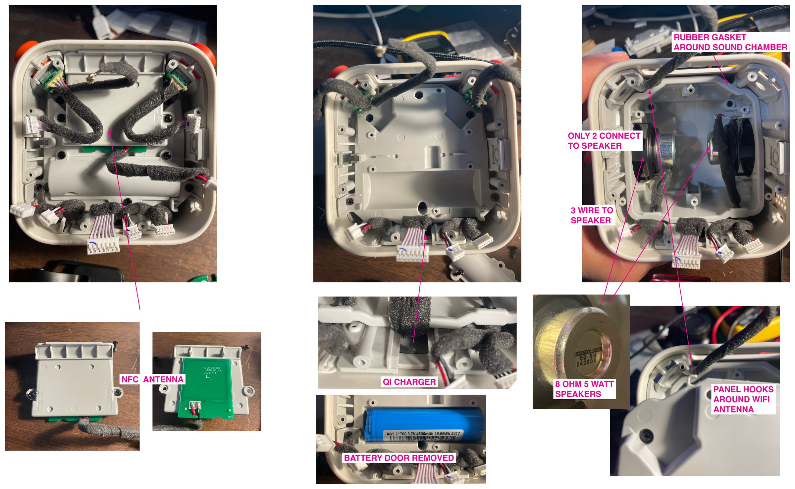
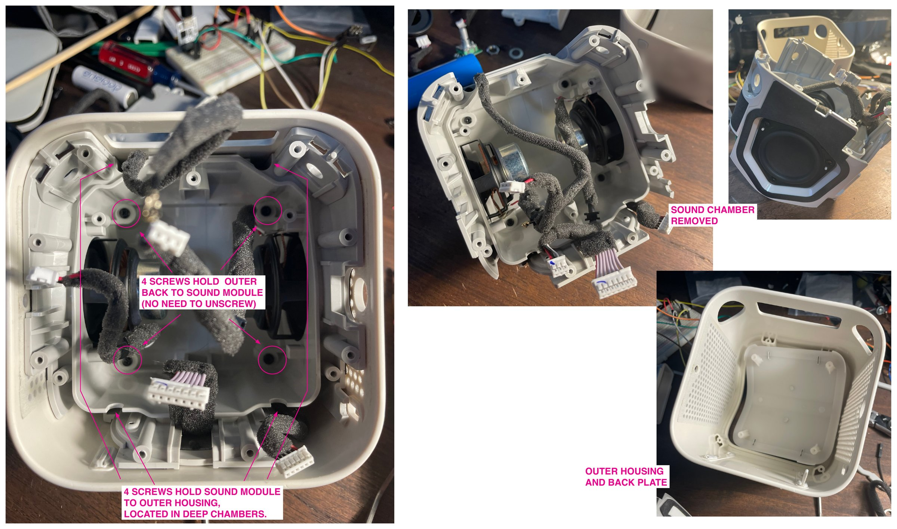
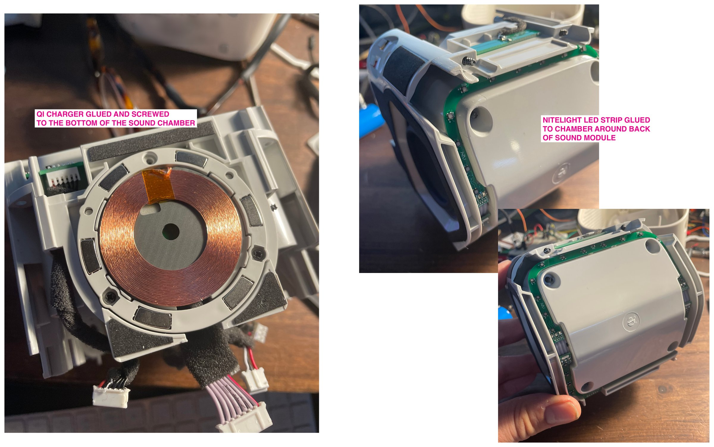

# Taking apart a Yoto Player V3

Everything inside connects by plug-in cables, so no soldering is needed to open it. Go slowly: the connectors are tight, and pulling on wires is the easy way to break something.

## Diffuser screen

1. Use a spudger to gently pry the diffuser screen on its inside edge.
2. Work slowly around the frame until the entire screen comes loose.

Notches around the LED channel frame hold the screen's clips, and one opening near the SD card reader is the window for the ambient light sensor. Photo 2 in the Board section marks them.

## Board

1. Remove the eight screws that hold the LED channel frame and PCB to the enclosure.
2. Lift the board partway. The bottom wires are slightly stiff, which makes the board hard to pull away.
3. Pry the connectors off. They take some work. **Do not pull on the wires.**

An alignment slot locates the PCB and LED channel frame when you reassemble it.

## Connectors

| Connector | Wires |
| --- | --- |
| Encoders | 4 each |
| NFC antenna | 2 |
| Night light | 6 |
| Qi | 7 |
| Speakers | 3 each |
| Battery | 3 |

See [`hardware-reference.md`](hardware-reference.md) for where each one goes.

## Card slot cover

Push the cover downward, parallel to the board, to release it. Do not pull on the keyed card slot.

## Encoder knobs

1. Press the knob's grooves through the slots while gently pulling out on the knob. The grooves snap into the enclosure.
2. Watch for a small loose spacer inside the knob. I'm not sure if it's necessary, so keep it.

The encoders use a D shaft.

The encoders must be fully removed in order to remove the panel covering the audio chamber (the back panel).

## Inside the enclosure

- Two 8 Ω, 5 W speakers sit in a sound chamber with a rubber gasket around it.
- Each speaker has a 3-wire lead, but only red and white connect to the speaker. Black stops inside the foam tape.
- A panel hooks around the Wi-Fi antenna.
- The battery sits behind a door.
- The Qi charger and NFC antenna are also inside. The NFC antenna sits under the card slot.

## Removing the sound chamber

The whole sound chamber comes out as one unit, so the speakers and gaskets don't need to come out individually.

1. Fully remove both encoders.
2. Remove the four screws that hold the sound module to the outer housing. They sit in deep chambers, so use a magnetized bit.
3. Lift the sound chamber out. Four other screws hold the outer back to the sound module, and those don't need to come out.

## Qi charger and night light

The Qi charger is glued and screwed to the bottom of the sound chamber. The night light LED strip is glued to the chamber around the back of the sound module. I couldn't remove either without breaking it, so I left them in place.

The Qi charger's ring of magnets is strong enough to pull screws off a driver. Before closing the player, make sure no loose screws are left inside.
