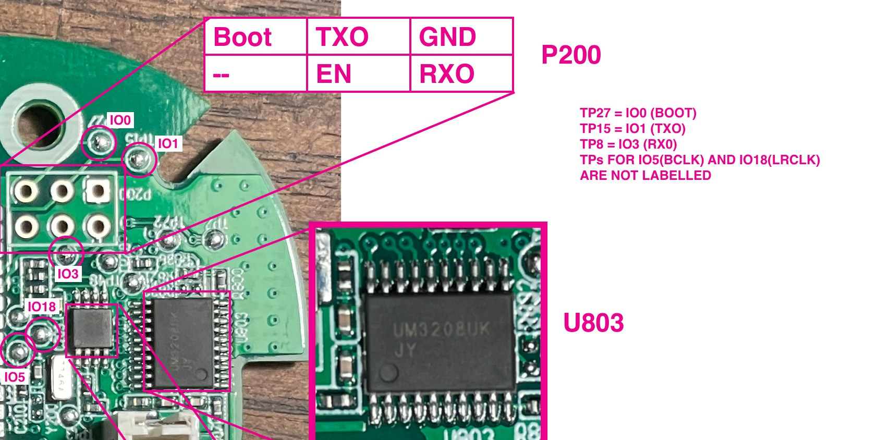

# Getting a Yoto Player V3 into download mode

The ESP32 can be read and flashed over serial through a small header. The chip on my board is fully unlocked. Check yours with `espefuse summary` before assuming the same.

**Back up first.** Flashing replaces the stock firmware, and a full dump is your only way back. Keep your dump private: it is Yoto's firmware, and it may hold your Wi-Fi details and device identity.

## What you need

- A 3.3 V USB-serial adapter. I used a CP2102. Its TX and RX stay at 3.3 V whatever its 5V/3.3V jumper says; the jumper only sets the power pin.
- [esptool](https://github.com/espressif/esptool)
- A way to hold wires on the pads and briefly ground IO0 and EN.

## Wiring

Header P200 is six through-hole pads beside the ESP32 module:



With the ESP32 module to the left, as in the photo:

| | | |
| --- | --- | --- |
| Boot (IO0) | TXO | GND |
| Unlabeled | EN | RXO |

The GND pad is the square one. The sixth pin is presumably 3V3. Leave it unconnected. Confirm the pins by continuity to the module before trusting any diagram, this one included.

Three of these signals also have labeled test points: TP27 is IO0 (BOOT), TP15 is IO1 (TX), and TP8 is IO3 (RX).

| Adapter | Player |
| --- | --- |
| GND | GND |
| TX | RX |
| RX | TX |
| Power pin | Not connected |

## Enter download mode

1. Power the player from its battery and turn it on with the power button, or plug USB-C into it. The board does nothing while off.
2. Hold BOOT (IO0 to GND).
3. Tap RESET (EN to GND).
4. Release BOOT.
5. Run esptool promptly.

To confirm it worked, open a serial monitor at 115200. You should see `waiting for download`. A normal reset prints the stock boot log, ending in "Welcome to Yoto".

The adapter has no auto-reset wiring, so esptool must be told not to try:

```
esptool --port /dev/cu.usbserial-XXXX --before no_reset --after no_reset read_flash 0 0x800000 yoto_v3_backup.bin
```

Replace the port with your own. On a Mac, `ls /dev/cu.*` lists them. Newer esptool versions also spell these with hyphens (`no-reset`, `read-flash`).

Take two dumps and compare them. Mine differed only in the nvs settings partition, about 1.6 KB, which is expected after the player boots between reads.

## Restore stock

In download mode:

```
esptool --port /dev/cu.usbserial-XXXX --before no_reset --after no_reset write_flash 0 yoto_v3_backup.bin
```

The full 8 MB dump includes the partition table. Do a full power cycle after any flash.

## Warnings

- **Never pull GPIO12 high at boot.** The fuses leave flash voltage selected by GPIO12. High selects 1.8 V and the board will not boot.
- The player has a 21700 lithium cell. Don't short it, pinch its wires, or leave an open player charging unattended.
- This voids any warranty, and you can brick your player. You do this at your own risk.
