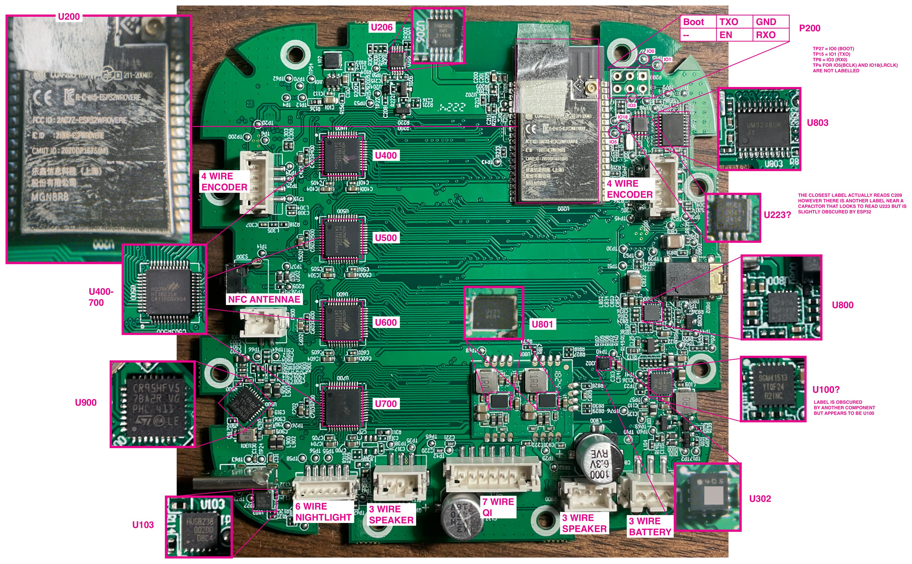
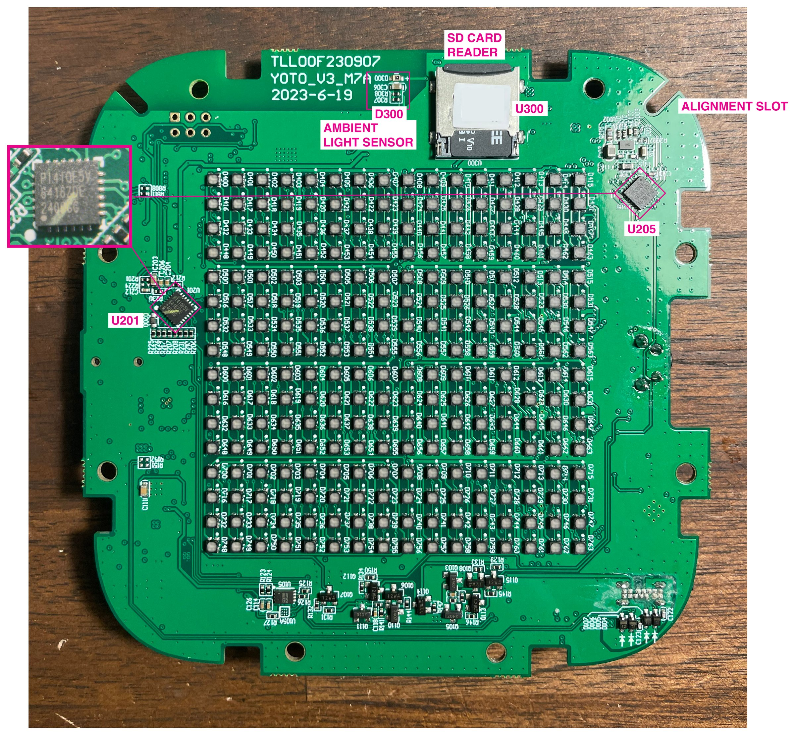

# Yoto Player V3 hardware reference

Everything here comes from one board. Treat it as a good starting point, and check your own.

Source tags:

- **[Board]** seen, measured, or read on this V3
- **[Config]** from the V3-E board config in the stock firmware
- **[Datasheet]** from the Awinic AW88194/AW88194A datasheets
- **[Inferred]** reasoned from the above, not directly confirmed

## Board identification

| Item | Value | Source |
| --- | --- | --- |
| Product | Yoto Player, 3rd generation (V3) | [Board] |
| Main board silkscreen | YOTO_V3_M7A, dated 2023-6-19 | [Board] |
| Audio module | Separate small PCB soldered to the main board, labeled "Player V3 Audio V3". Designator U801 covers the whole module | [Board], FCC photos |
| MCU | ESP32-WROVER-E N8R8 (8 MB flash, 8 MB PSRAM), wafer revision 3.1 | [Board] |
| Matching firmware config | V3-E | [Config] |

**V3-E, not V3.** The firmware holds configs for several similarly named models. The V3-E entry is the one whose parts match this board: PI4IOE5V6416 expanders (V3 lists ET6416), an SGM41513 charger at 0x1A (V3 lists SGM41511), and a battery gauge at 0x64. Other entries describe single-amp models and an older player with an ES8388 codec at 0x10. GPIO assignments differ between entries, so read only from V3-E.

## Security fuses

| Fuse | Value | Meaning |
| --- | --- | --- |
| FLASH_CRYPT_CNT | 0 | Flash encryption off |
| ABS_DONE_0 / ABS_DONE_1 | False | Secure boot off |
| BLOCK1–3 keys | All zeros | No keys burned |
| UART_DOWNLOAD_DIS | False | Serial download allowed |
| JTAG_DISABLE | False | JTAG available |

## I2C bus

SDA GPIO21, SCL GPIO25. [Config]

| Address | Chip | Function | Source |
| --- | --- | --- | --- |
| 0x08 | HUSB238 | USB-C power delivery | Scan, [Config] |
| 0x09 | ES8156 | Headphone DAC | Scan, [Config] |
| 0x18 | LIS2DH12 | Accelerometer, likely U302 | Scan, [Board], [Inferred] from the chip's usual address |
| 0x1A | SGM41513 | Battery charger | Scan, [Config] |
| 0x20 | PI4IOE5V6416 | IO expander, ports p0–p1 | Scan, [Board], [Config] |
| 0x21 | PI4IOE5V6416 | IO expander, ports p2–p3 | Scan, [Board], [Config] |
| 0x34 | AW88194 | Speaker amp, left per config | Scan after wake-up, [Config] |
| 0x37 | AW88194 | Speaker amp, right per config | Scan after wake-up, [Config] |
| 0x51 | IT8563 / PCF8563-type | Real-time clock | Scan, [Config] |
| 0x62 | CW2015, very likely (U105) | Battery fuel gauge | Scan, [Board], [Inferred] from the chip marking and CW2015's usual address |
| 0x64 | CW2215B per V3-E config, but see note | Battery fuel gauge | Earlier scan, [Config]. Did not answer in the amp-test scan. U105 suggests a CW2015 is fitted instead |
| 0x65 | AW2028H, likely | Night light LED driver | Scan, [Inferred] from open-yoto's notes on the stock firmware |
| 0x75 | Unknown | | Scan |

Not on the bus: the Qi receiver (CV8013N, no I2C address in the config) and the NFC reader (UART).

## GPIO

From the V3-E config. Nearly every usable pin is taken.

| GPIO | Function |
| --- | --- |
| 0 | I2S MCLK, also the BOOT strapping pin |
| 1 / 3 | UART0 TX / RX, programming header |
| 2 | SD card D0 |
| 4 | Right encoder B |
| 5 | I2S BCLK |
| 12 | Unused in config. Strapping pin: never pull high at boot |
| 13 | Left encoder B |
| 14 | SD card CLK |
| 15 | SD card CMD |
| 16 / 17 | Used internally by PSRAM on WROVER modules |
| 18 | I2S LRCLK |
| 19 | I2S data out |
| 21 | I2C SDA |
| 22 | SPI MOSI, display |
| 23 | SPI SCLK, display |
| 25 | I2C SCL |
| 26 | Left encoder A (config also lists SPI MISO here) |
| 27 | Right encoder A |
| 32 / 33 | NFC reader UART RX / TX |
| 34 | IO expander interrupt, input only |
| 35 | Qi receiver temperature sensor, ADC |
| 36 | Ambient light sensor D300, ADC. Connection confirmed by continuity [Board] |
| 39 | Temperature sensor, ADC. Location unknown: not the speaker black wire or the battery's third wire [Board] |

Test points [Board], shown in [this photo](../photos/09-programming-header-detail.jpg):

| Test point | Signal |
| --- | --- |
| TP27 | GPIO0, BOOT |
| TP15 | GPIO1, UART TX |
| TP8 | GPIO3, UART RX |
| Unlabeled, below P200 | GPIO5, I2S BCLK |
| Unlabeled, below P200 | GPIO18, I2S LRCLK |

## IO expander

The config names expander pins IOX.\<port\>.\<bit\>, counting four 8-bit ports across two chips: p0–p1 on 0x20 and p2–p3 on 0x21. The port-to-chip order is [Inferred], and the speaker test is consistent with it.

| Pin | Function | Direction |
| --- | --- | --- |
| IOX.0.0 | Qi I2C interrupt | Output per config, unexpected |
| IOX.0.1 | RTC interrupt | Input |
| IOX.0.4 | Right encoder push | Input |
| IOX.0.5 | Left encoder push | Input |
| IOX.0.6 | Battery gauge alert | Input |
| IOX.0.7 | Qi status, active low | Input |
| IOX.1.0 | USB VBUS status, active low | Input |
| IOX.1.1 | Headphone detect | Input |
| IOX.1.2 | Tilt indicator | Input |
| IOX.1.3 | Power button | Input |
| IOX.1.4 | Charger status | Input |
| IOX.2.0–2.3 | Display LED driver chip selects | Output, high |
| IOX.2.4 | **Speaker amp control** | Output, high |
| IOX.2.5 | Power enable | Output, low |
| IOX.2.6 | Qi charge enable, active low | Output, high |
| IOX.2.7 | USB charge enable, active low | Output, low |
| IOX.3.0 | Level converter enable | Output, high |
| IOX.3.1 | Power hold, the power latch | Output, high |
| IOX.3.3 | Output power enable | Output, high |
| IOX.3.5 | Qi 5 W enable | Output, low |

Stock startup values (write outputs before directions so pins don't glitch):

| Chip | Output p0 (0x02) | Output p1 (0x03) | Direction p0 (0x06) | Direction p1 (0x07) |
| --- | --- | --- | --- | --- |
| 0x20 | 0xFF | 0xFF | 0xFE | 0xFF |
| 0x21 | 0x5F | 0xDF | 0x00 | 0xD4 |

In direction registers, 1 = input and 0 = output. Pull-ups are off.

## Storage

**microSD** (GPIO2/14/15), about 171 MB used on my card. It holds cached card audio in randomly named folders, plus card data, icons, app settings, and a resume record. Settings include schedules, brightness, volume caps, and a 1-hour auto shutdown.

**Flash layout** (8 MB), from the dump's partition table:

| Offset | Size | Name | Type |
| --- | --- | --- | --- |
| 0x001000 | 28 KB | bootloader | Boot |
| 0x008000 | 4 KB | partition table | Table |
| 0x009000 | 192 KB | nvs | Settings |
| 0x039000 | 8 KB | otadata | Firmware slot selection |
| 0x03B000 | 4 KB | phy_init | Radio calibration |
| 0x040000 | 2560 KB | factory | Firmware |
| 0x2C0000 | 2560 KB | ota_0 | Firmware update slot |
| 0x540000 | 2560 KB | ota_1 | Firmware update slot |

## Connectors

Everything inside uses plug-in cables, so the player comes apart and goes back together without soldering.

| Connector | Wires | Goes to | Source |
| --- | --- | --- | --- |
| Left and right speakers, bottom edge | 3 each: red, black, white | 8 Ω, 5 W speakers. Red and white reach the speaker, reading 8.2 Ω and 6.7 Ω. Black stops inside the foam tape, reads open to red and white, and connects to ground on the board, so it's likely a shield | [Board], shield [Inferred] |
| Battery, bottom right | 3 | A&S 21700 cell, 3.7 V, 4500 mAh, with a small PCB on top. Yellow is the third wire. It reads 11.36 kΩ to black at room temperature, which fits a 10 kΩ thermistor. It doesn't connect to GPIO39 or ground on the board | [Board], thermistor [Inferred] |
| Encoders, top left and top right | 4 each | The two dials | [Board] |
| NFC, left edge | 2 | NFC antenna board under the card slot | [Board] |
| P201, bottom | 7 | Qi receiver at the base | [Board] |
| P303, bottom | 6 | Night-light LEDs around the rear edge | [Board] |
| ESP32 antenna socket | Coax | External Wi-Fi antenna cable, routed under a panel hook | [Board] |

The V3-E config lists a different battery (EVE-LJDX90X-4900) than the fitted A&S cell, which is the plain V3 entry's part. U105 is also the plain V3 entry's gauge type, so this board may mix parts from both entries. Everything tested from the V3-E entry has worked so far, including the amps, expanders and I2S pins. [Inferred]

## Chips

| Designator | Marking | Part | Function | Status |
| --- | --- | --- | --- | --- |
| U200 | ESP32-WROVER-E | ESP32 module | Main processor | Confirmed |
| U201, U205 | PI4IOE5V6416 | PI4IOE5V6416 | IO expanders | Confirmed |
| U206 | SGM3002 XMS 2146N | SGMicro part | Likely a voltage regulator | Inferred |
| Likely U223 | 8563 | IT8563 / PCF8563-type | Real-time clock | Part confirmed, designator crowded |
| U400, U500, U600, U700 | HT16D35A | HT16D35A | Display LED drivers, 16×16 grid on the reverse of the board | Confirmed |
| U801 | "Player V3 Audio V3" | Audio module | Holds both amps and boost inductors | Confirmed |
| On U801, no designators | UV25 | AW88194ACSR | Speaker amps | Confirmed |
| U800 | ES8156 | ES8156 | Headphone DAC | Confirmed |
| U803 | UM3208 | UM3208 | Level translator | Confirmed |
| U900 | CR95HF | CR95HF | NFC reader | Confirmed |
| U103 | HUSB238 | HUSB238 | USB-C power delivery | Confirmed |
| U100, silkscreen hidden | SGM41513 | SGM41513 | Battery charger | Part confirmed |
| U300 | | microSD socket | Storage | Confirmed |
| D300 | | Light sensor, part unidentified | Ambient light sensor on GPIO36, seen through an opening in the LED frame, with R307, R308 and C306 beside it | Confirmed by continuity |
| U302 | 4D5, with data matrix | LIS2DH12, very likely | Accelerometer (0x18), next to TP40. About 2 mm square, package matches the datasheet, pin 1 connects to SCL | Very likely |
| Night light board | Not photographed | AW2028H, likely | Night light LED driver, likely 0x65 | Inferred |
| Qi board | Not photographed | CV8013N, likely | Wireless charging receiver | Inferred |
| U105 | 2015CH BDLR23 | CW2015CHBD, very likely | Battery fuel gauge, on the opposite side of the board near the battery connector | Very likely |
| U105A | Empty | Not fitted | 3×3 pad grid beside U105. Fits a WLCSP-9, the package listed for the CW2215B, so likely an alternate gauge footprint | Inferred |
